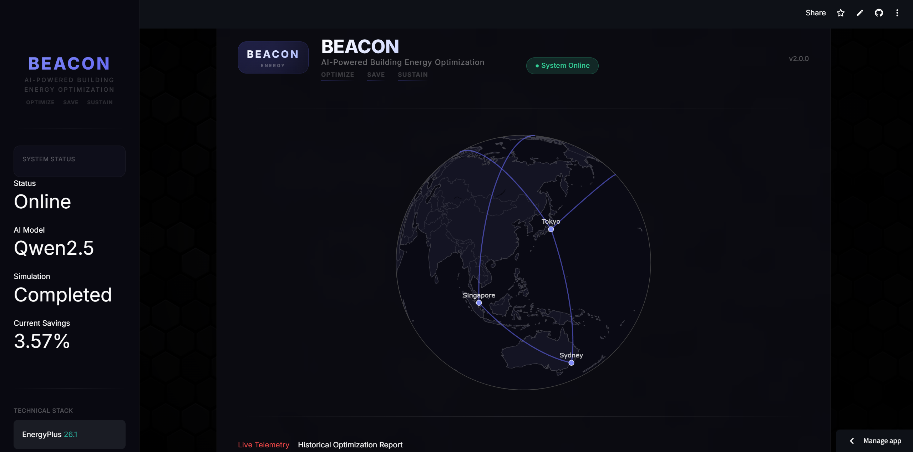
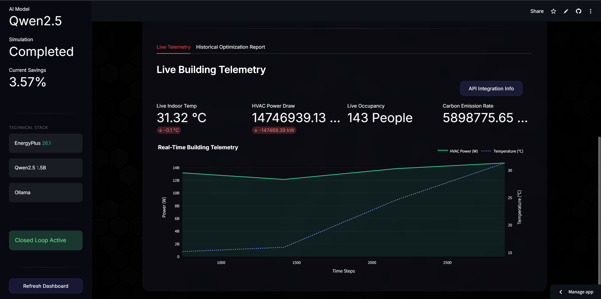
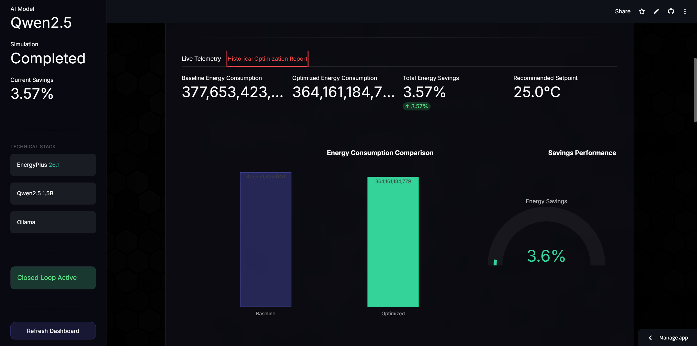
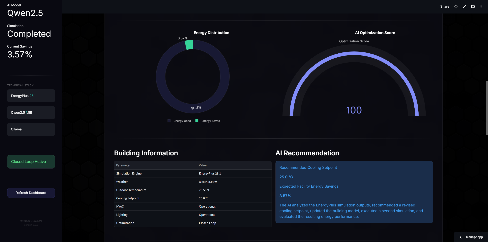
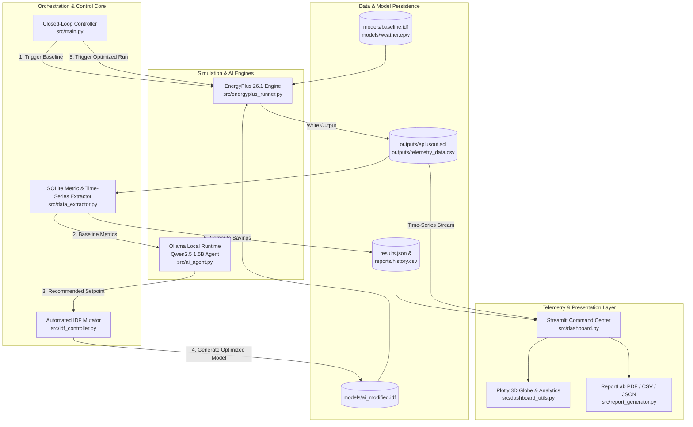

<div align="center">
  

  <br />
  <br />

  <h1 align="center">B.E.A.C.O.N.</h1>
  <h3 align="center">Building Energy Analytics & Control Optimization Network</h3>
  <p align="center"><em>AI-Powered Closed-Loop Building Energy Optimization & Real-Time Telemetry Platform</em></p>

  <p align="center">
    <a href="https://beacon-fuqtpoomdhrfdzhksccvvu.streamlit.app/"><strong>Explore the Live Platform »</strong></a>
  </p>

  <p align="center">
    
    
    
    
    
    
    
  </p>
</div>

<hr />

## System Overview

**BEACON** (*Building Energy Analytics & Control Optimization Network*) is an autonomous, closed-loop building energy intelligence platform that converges high-fidelity **EnergyPlus thermodynamic simulations** with **local Large Language Model (LLM) inference** to analyze facility performance, synthesize optimal HVAC control strategies, programmatically mutate building input definitions, and verify electricity savings without human intervention.

Traditional building energy modeling workflows require HVAC engineers to manually inspect gigabytes of SQLite simulation outputs, heuristically tune cooling schedules, edit raw `.idf` files, and re-execute simulations iteratively. BEACON eliminates this bottleneck by orchestrating the entire analyze-optimize-verify loop autonomously while exposing a real-time telemetry command center for continuous facility monitoring.

---

## Core Capabilities & System Features

### 1. Autonomous Closed-Loop Simulation Pipeline
BEACON executes baseline EnergyPlus simulations against real-world `.epw` weather profiles and `.idf` building geometry models, extracts granular electrical and thermal metrics from the resulting SQLite database, and validates AI-recommended control changes by running a secondary verification simulation.

### 2. Privacy-First Local LLM Reasoning Engine
Powered by **Qwen2.5 (1.5B)** running locally via **Ollama**, BEACON evaluates ambient drybulb temperatures alongside facility and building electricity loads. It synthesizes natural-language engineering diagnostics and outputs deterministic HVAC cooling setpoint recommendations with zero cloud API latency or external data exposure.

### 3. Programmatic IDF Schedule Mutation
The platform's IDF controller parses EnergyPlus Input Data Files (`baseline.idf`), locates active HVAC cooling setpoint schedules, injects the AI-recommended thermal parameters into a dedicated optimization model (`ai_modified.idf`), and triggers verification runs automatically.

### 4. Real-Time Building Telemetry & IoT Command Center
The Streamlit interface operates as a dual-mode command center featuring an isolated fragment execution loop (`@st.fragment`) that streams time-stepped facility telemetry—tracking live indoor temperature, active HVAC power draw (kW), occupancy load, and carbon emission rates ($\text{kgCO}_2/\text{h}$) across a dynamic dual-axis area chart.

### 5. Interactive 3D Geospatial & Analytics Visualization
Equipped with an auto-rotating 3D orthographic globe and custom glassmorphic Plotly visualizations, the dashboard provides executive visibility into baseline-vs-optimized consumption, energy distribution rings, optimization scoring gauges, and multi-run historical trends.

### 6. Automated Multi-Format Compliance Reporting
Upon completion of each closed-loop cycle, BEACON compiles audit-ready documentation in **PDF** (via ReportLab), **CSV**, and **JSON** formats, while appending run performance to a persistent historical ledger (`reports/history.csv`).

---

## Platform Preview

| 3D Global Network & Command Center | Live Building Telemetry Stream |
| :---: | :---: |
|  |  |
| **Energy Consumption & Savings Analytics** | **AI Optimization Score & Diagnostics** |
|  |  |

---

## Technical Architecture

BEACON enforces a strict separation of concerns across simulation execution, SQLite metric extraction, local LLM inference, IDF mutation, and real-time telemetry presentation.



### Component Stack Breakdown

| Layer | Technology | Role |
| :--- | :--- | :--- |
| **Simulation Engine** | EnergyPlus 26.1 | Whole-building thermodynamic & HVAC load simulation |
| **AI Reasoning Core** | Qwen2.5 1.5B + Ollama | Local LLM inference for thermal setpoint optimization |
| **Backend & Orchestration** | Python 3.13, SQLite3 | Pipeline automation, IDF parsing, and SQLite telemetry extraction |
| **Frontend Command Center** | Streamlit 1.60 | Glassmorphic web interface and real-time fragment streaming |
| **Data Visualization** | Plotly 6.9, Pandas 3.0 | 3D orthographic globe, dual-axis telemetry, and gauge indicators |
| **Document Generation** | ReportLab 5.0 | Automated generation of executive PDF, CSV, and JSON reports |

---

## Empirical Simulation Benchmark

In benchmark testing using the reference commercial building model (`models/baseline.idf`) and weather profile (`models/weather.epw`), BEACON autonomously identified cooling schedule inefficiencies and adjusted the HVAC cooling setpoint from **23.9 °C** to **25.0 °C**, achieving a verified **3.57% reduction** in total facility electricity consumption while maintaining occupant thermal comfort.

| Performance Metric | Baseline Run | AI-Optimized Run | Delta / Impact |
| :--- | ---: | ---: | ---: |
| **Average Outdoor Air Drybulb Temp** | 25.58 °C | 25.58 °C | — |
| **HVAC Cooling Setpoint** | 23.90 °C | **25.00 °C** | +1.10 °C |
| **Building Electricity Consumption** | 257,872,140,000 J | 257,872,140,000 J | 0.00% |
| **Total Facility Electricity Consumption** | 377,653,423,040 J | **364,161,184,779 J** | **-13.49 GJ (-3.57%)** |

---

## Hardware & BMS Integration Specification

For physical building deployments, BEACON supports ingesting live sensor streams from Building Management Systems (BMS) via REST API or MQTT brokers:

- **REST Endpoint:** `POST /api/v1/telemetry`
- **MQTT Topic:** `mqtt://beacon-broker.local:1883` → `beacon/telemetry/live`

```json
{
  "sensor_id": "bldg_zone_1",
  "timestamp": "2026-08-27T10:00:00Z",
  "metrics": {
    "temperature_c": 22.4,
    "hvac_power_w": 10450,
    "occupancy_count": 142
  }
}
```

---

## Repository Structure

```text
BEACON/
├── assets/                     # UI background textures and platform preview screenshots
│   ├── bg.jpg                  # Custom hexagon dark-mode background texture
│   ├── dashboard_preview.png   # 3D Globe & Command Center overview
│   ├── telemetry_stream.png    # Real-time building telemetry stream view
│   ├── analytics_preview.png   # Baseline vs. Optimized comparison charts
│   ├── optimization_score.png  # Energy distribution & AI optimization score
│   └── pipeline_preview.png    # Optimization pipeline & AI decision summary
├── models/                     # EnergyPlus building models and weather profiles
│   ├── baseline.idf            # Reference commercial building input definition
│   ├── ai_modified.idf         # AI-mutated building model with optimized schedule
│   └── weather.epw             # EnergyPlus weather data profile
├── outputs/                    # Extracted simulation time-series data
│   └── telemetry_data.csv      # Pre-extracted time-stepped telemetry for cloud streaming
├── reports/                    # Generated audit reports and historical run ledger
│   ├── energy_report.pdf       # Executive PDF optimization report
│   ├── energy_report.csv       # Tabular comparison export
│   ├── energy_report.json      # Machine-readable run summary
│   └── history.csv             # Multi-iteration savings history
├── src/                        # Core Python source modules
│   ├── main.py                 # End-to-end closed-loop orchestration entrypoint
│   ├── ai_agent.py             # Ollama + Qwen2.5 prompt engineering & parser
│   ├── idf_controller.py       # Automated IDF cooling schedule modifier
│   ├── energyplus_runner.py    # Subprocess wrapper for EnergyPlus CLI execution
│   ├── data_extractor.py       # SQLite & CSV metric/telemetry extraction engine
│   ├── dashboard.py            # Streamlit command center application
│   ├── dashboard_utils.py      # Custom Plotly 3D globe and chart builders
│   ├── report_generator.py     # ReportLab PDF, CSV, and JSON export module
│   ├── config.py               # Centralized filesystem & binary path configuration
│   └── run_baseline.py         # Standalone baseline simulation runner
├── CONTRIBUTING.md             # Contributor workflow and coding standards
├── LICENSE                     # MIT License
├── README.md                   # Project documentation
├── requirements.txt            # Locked Python package dependencies
└── results.json                # Latest verified closed-loop simulation metrics
```

---

## Deployment & Local Development Guide

### Prerequisites

1. **Python 3.10+**
2. **[EnergyPlus 26.1.0](https://energyplus.net/downloads)** (Installed at `C:\EnergyPlusV26-1-0\energyplus.exe` or configured in `src/config.py`)
3. **[Ollama](https://ollama.com)** with the `qwen2.5:1.5b` model pulled locally

### 1. Clone the Repository & Install Dependencies

```bash
git clone https://github.com/m4n1kya/Beacon.git
cd Beacon

# Create and activate virtual environment (Windows)
python -m venv venv
venv\Scripts\activate

# Install Python dependencies
pip install -r requirements.txt
```

### 2. Provision the Local AI Runtime

```bash
# Pull the Qwen2.5 1.5B model
ollama pull qwen2.5:1.5b

# Start the local Ollama inference server
ollama serve
```

### 3. Execute the Closed-Loop Optimization Pipeline

```bash
cd src
python main.py
```

### 4. Launch the Real-Time Command Center

```bash
streamlit run src/dashboard.py
```
Access the local web application at `http://localhost:8501`.

---

## Contributing

Contributions are welcome! Please review our [Contributing Guidelines](CONTRIBUTING.md) prior to opening issues or submitting pull requests.

---

## License & Author

- **License:** Distributed under the [MIT License](LICENSE).
- **Author:** Developed by **[Manikya N.](https://github.com/m4n1kya)** — B.Tech Computer Science & Engineering, VIT Bhopal University.